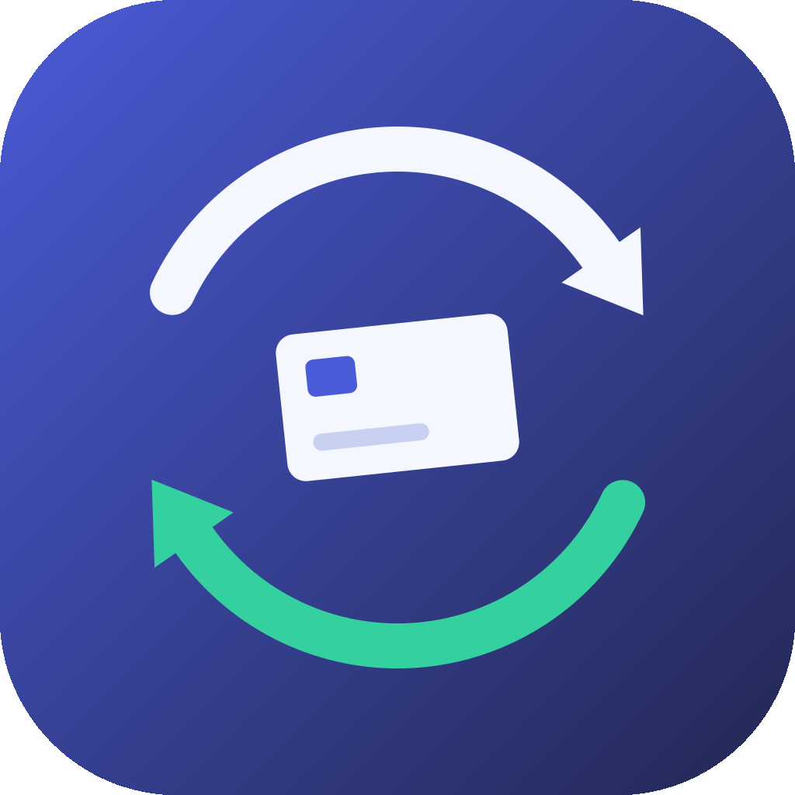

<p align="center">
  
</p>

# Substrackt

[](https://github.com/VolodymyrGalushka/Substrackt/actions/workflows/builds.yml)

A desktop app for Linux, macOS and Windows that tracks subscriptions: what you
pay, how often, with which payment method, and when it renews next. Everything
runs on your machine —
data lives in a local SQLite database, secrets live in your OS keyring, and
nothing is sent anywhere unless you explicitly point it at your own services.

## Features

**Know what you pay**
- Dashboard with monthly spend, spending by payment method and upcoming renewals.
- Subscriptions with amount, currency, billing interval and next renewal —
  month ends are handled safely (a January 31st renewal lands on February 28th).
- Payment methods are stored as **metadata only** — label, issuer, network, last
  four digits. Card numbers and CVVs are never accepted or stored.

**Capture from anywhere**
- **Import text** — paste any receipt or email and let the pipeline read it.
- **Email sources** — connect an IMAP mailbox (Yahoo, Gmail, iCloud, Fastmail,
  Outlook/Microsoft 365 or a custom server). Syncs are incremental; obvious
  non-billing mail is skipped before anything else happens.
- **Browser sources** — sign in to a vendor's billing page (GitHub first) from
  the browser you already use; only that vendor's session cookies are imported.
- **API sources** — read subscriptions straight from Stripe or Paddle with a
  read-only API key.
- All of them feed one shared pipeline: dedupe → extract → match → review.

**Extraction with a local model (optional)**
- Uses any OpenAI-compatible endpoint on your machine or private network —
  Ollama, LM Studio, llama.cpp, a home-lab box. Nothing is sent to hosted AI
  services; a non-local endpoint only works after you accept an explicit
  warning that your documents will be sent there.
- Unambiguous, high-confidence proposals can be applied automatically
  (adjustable threshold). Price changes and cancellations always wait for you.

**Stay in control**
- **Review queue** with one-click accept/reject and bulk actions.
- **Activity** page showing import job progress and recent model calls
  (tokens, latency, results — prompts and answers are never stored).
- Light, dark and **use system theme**, following your desktop live.

## Requirements

- **Go 1.27.4** — pinned in `.tool-versions` for asdf. Run `asdf install` in this
  directory to install it.
- **Node.js + npm** — used by Vite to build the frontend.
- **Wails 3 CLI** (`wails3`, v3.1.0):

  ```sh
  go install -tags gtk3 github.com/wailsapp/wails/v3/cmd/wails3@v3.1.0
  ```

- **Platform toolchain** — Linux needs the GTK 3 and WebKit2GTK 4.1
  development packages (e.g. `gtk3-devel`, `webkit2gtk-4.1-devel` on Fedora),
  macOS needs the Xcode Command Line Tools, and Windows needs nothing extra.
  GitHub Actions builds all three platforms on every push and tag
  (`.github/workflows/builds.yml`), so prebuilt binaries exist without a local
  toolchain.

## Build and run

```sh
wails3 dev               # run with hot reload
wails3 build             # production build for the host -> bin/
wails3 task darwin:package  # macOS: build + unsigned .app bundle
wails3 task windows:build   # Windows: portable .exe
wails3 generate bindings -ts -i  # regenerate TS bindings after Go service changes
npm --prefix frontend run check   # svelte-check (types + a11y)
go test -tags gtk3 ./internal/... # domain, store and service tests
```

Tagged releases (for example `v0.2.0`) produce a GitHub release with the Linux
tarball, the macOS `.app` bundle and the Windows `.exe`, plus checksums.

## Installing on Linux

Linux releases ship as native packages rather than a single universal binary —
GTK and WebKit are system libraries and must come from your distribution:

- **`.deb`** — Debian 12+, Ubuntu 22.04+, Mint, Pop!_OS. Pulls
  `libgtk-3-0` and `libwebkit2gtk-4.1-0` automatically.
- **`.rpm`** — Fedora 36+, RHEL/AlmaLinux/Rocky (needs `gtk3` +
  `webkit2gtk4.1` packages, provided by the repos).
- **`.AppImage`** — carries its own GTK and WebKit libraries; runs on any
  reasonably modern distribution without installing anything.
- **Arch** — build from source with `wails3 task linux:create:aur` and install
  the generated `substrackt.pkg.tar.zst` with `pacman -U`.

One build serves all of these; only the packaging differs.

## Where your data lives

`<user config dir>/Substrackt/substrackt.db` (e.g. `~/.config/Substrackt/` on
Linux). Set `SUBSTRACKT_HOME` to use a different directory. Source passwords,
vendor sessions and API keys are kept in the OS keyring — or in
`<config dir>/Substrackt/secrets/` as an encrypted `0600` file when no keyring
is available. They are never written to the database, never sent to the
interface, and never appear in logs.

## Adding subscriptions

### Import text

**Review queue → Import text** (or **Activity → Import text**) queues a job for
pasted receipt or email text. The pipeline normalises the content, dedupes by
SHA-256, extracts fields with local rules, and — when a model is configured in
**Settings** — validates a JSON extraction from it. Results land in **Review
queue**, except for unambiguous high-confidence proposals when auto-apply is on.

### Email

**Sources → Add source** configures an IMAP mailbox, starting from a provider
preset (Yahoo, Gmail, iCloud, Fastmail, Outlook/Microsoft 365, or custom).
Encryption is implicit TLS (normally 993), STARTTLS (normally 143), or plain TCP
for local/private test servers only. Authentication is `auto` (LOGIN, falling
back to SASL PLAIN/LOGIN when the server disables LOGIN), `login`, `plain`, or
`xoauth2`, where the credential field holds an OAuth2 access token. Presets fill
only the server address and encryption, so app passwords and API tokens are
optional: try your account password first, and switch to an app password or
XOAUTH2 token only if the provider rejects it. When a provider does reject an
account password (common with two-factor authentication), generate an app
password (Yahoo Account Security → Generate app password, Google Account → App
passwords, an app-specific password for iCloud), or use XOAUTH2 where basic IMAP
auth is disabled, such as Microsoft 365. The password field has
**Show/Hide**, and an existing source can load its saved credential into the
editor explicitly with **Reveal saved**.

**Test connection** checks the credentials without saving. **Sync now** queues an
email job; enabled sources are also polled on their schedule. Each sync reads a
per-mailbox cursor, fetches only newer messages (or a bounded recent window
on the first run), parses MIME text/HTML, and sends each message through the same
pipeline as manual imports. Obvious non-billing mail is skipped before the model;
everything else lands in **Review queue**. A changed mailbox UID validity triggers a
rescan, and failures are recorded on the source without losing the last good
cursor.

### Vendor websites (browser)

**Sources → Add source → Vendor website (browser)** signs in to a vendor's own
billing page. The first connector is **GitHub**; the page list is extensible in
`internal/browser`. Choose the connector and, if needed, override the billing URL
(it must stay on the vendor's host), then **Add source**. By default, **Sign in**
opens a new tab in your existing browser, where you complete the normal
password/2FA/SSO flow; Substrackt imports only that vendor's session cookies and
stores them as a secret. The isolated method instead
opens a separate Playwright window, waits for the vendor's signed-in page and
closes it. **Cancel sign-in** stops waiting and leaves the source signed out.

**Sync now** and the schedule run the page headlessly with that session. The
visible text is redacted and sent through the same pipeline as email and manual
text, so dedupe, extraction, matching and review are shared. If the session
expires, it is removed and the card asks you to sign in again. The Playwright
driver and Chromium are downloaded on first use through **Install browser
runtime** (or automatically on the first sign-in) into the local Playwright
cache; they are not bundled with the app.

**Settings → Browser sign-in** chooses how sign-in works. **Use my default
browser** opens a new tab in the browser you already use and imports only the
vendor's session cookies after you sign in, so an existing Google account is
reused. **Open an isolated browser** keeps the old Playwright window. The
**Browser for isolated sign-in and sync** setting selects the binary used for
headless sync (**Automatic** prefers installed Chrome, Brave, Chromium or Edge,
then bundled Chromium). On Windows, browsers using App-Bound Encryption may
require the isolated method.

### Vendor APIs

**Sources → Add source → Vendor API** reads structured subscriptions from a
vendor's API. The first connectors are **Stripe** and **Paddle**; both accept a
read-only API key, stored in the OS keyring or the encrypted fallback and never
returned by the interface. The API host must be https. **Sync now** and the
schedule enqueue a sync job that reads the account's subscriptions, maps them to
the same subscription model used by email and browser sources, and lets the
shared pipeline match or propose them. Price or status changes go through the
review queue.

## Dependencies

- `modernc.org/sqlite` — pure-Go SQLite driver (no cgo).
- `github.com/emersion/go-imap/v2` + `github.com/emersion/go-message` — IMAP and
  MIME parsing for email sources.
- `github.com/ChristopherDavenport/cookiecracker` — reads the default browser's
  vendor cookies for default-mode sign-in.
- `github.com/mxschmitt/playwright-go` — headed interactive sign-in and headless
  billing-page reads for browser sources.
- `github.com/zalando/go-keyring` — OS keyring access, with the encrypted file
  fallback in `internal/secrets`.

## License

Substrackt is licensed under the **Functional Source License, Version 1.1,
ALv2 Future License** ([`LICENSE`](LICENSE)) — see the
[FSL FAQ](https://fsl.software/) for background.

In short: you can read, study, modify and run Substrackt for almost any
purpose, including internal use and non-commercial research. What you may not
do is offer a competing product or service — one that substitutes for
Substrackt or offers substantially similar functionality. Two years after each
version is published, that version converts to the **Apache License 2.0** and
becomes fully open source.

Contributions are welcome: open an issue or a pull request, and your changes
will be accepted under the same license.
